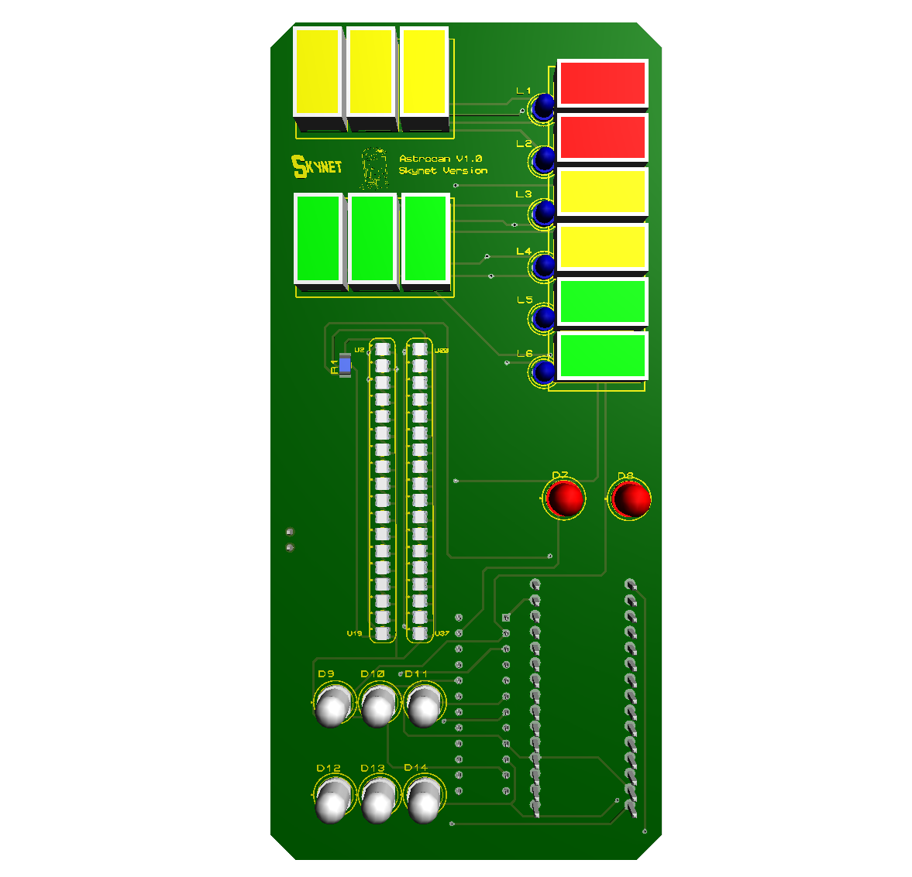

# AstroCan V1.3 - Système d'affichage pour R2-D2 (Skynet Version)

Bienvenue sur le dépôt officiel du projet **AstroCan V1.3** ! Ce système électronique et lumineux est conçu sur mesure pour être intégré dans un dôme / corps de droïde R2-D2.

> ⚠️ **Note sur les versions :** La version actuelle documentée et disponible dans ce dépôt est la **V1.3**. Une version **V2.0** apportant des améliorations logicielles et matérielles est actuellement en cours de développement et arrivera prochainement !

## 📸 Aperçu

<p align="center">
  
</p>

## 🛠️ Caractéristiques du Système

* **Contrôleur principal :** Arduino Nano V3.
* **Affichages bargraphes & effets complexes :** 36x LEDs adressables WS2812C-2020 (organisées en 2 colonnes de 18 LEDs).
* **Contrôleur de matrice LEDs :** MAX7219 pour la gestion synchrone des voyants et indicateurs.
* **Visualiseurs & LEDs d'état :**
  * **LEDs bleues 3 mm (x6) :** Indicateurs L1 à L6 (`LB`).
  * **LEDs blanches 5 mm (x6) :** Indicateurs D9 à D14 (`LW`).
  * **LEDs rouges 5 mm (x2) :** D7 et D8.
  * **Afficheurs & Voyants :** Modules Y1-Y5 (Jaune), V1-V5 (Vert) et RE1-RE2 (Rouge).

## 📂 Contenu du Dépôt

```
.
├── Gerber/                   # Fichiers Gerber V1.3 pour la fabrication du PCB
│   ├── AstroCan1.3 - CADCAM Top Copper.GBR
│   ├── AstroCan1.3 - CADCAM Bottom Copper.GBR
│   ├── AstroCan1.3 - CADCAM Drill TOP-BOT Plated.GBR
│   └── ...
├── Firmware/                 # Code source Arduino
│   └── AstroCan_V1.3.ino
├── Hardware/                 # Images, schémas et nomenclature
│   ├── Bill Of Materials AstroCan1.3.pdf
│   └── Vue_Avant_Astrocan.png
└── README.md                 # Documentation du projet
```

## 📊 Nomenclature (Bill of Materials - BOM)

Coût estimé des composants : **~25,28 €**

### 1. Circuit Imprimé & Contrôle

| Quantité | Référence | Composant / Valeur | Emplacement / Vendeur |
| :---: | :---: | :---: | :---: |
| **1** | A1 | Arduino Nano V3 | Aliexpress |
| **1** | U1 | MAX7219 (DIP/SOP) | Aliexpress |
| **36** | U2-U37 | WS2812C-2020 | Aliexpress |

### 2. Résistances & Condensateurs

| Quantité | Référence | Valeur | Note / Référence |
| :---: | :---: | :---: | :---: |
| **1** | R1 | 330 Ω | Digikey 311-330FTR-ND |
| **1** | R2 | 2.2 kΩ | Digikey 311-330FTR-ND |
| **1** | C1 | 470 µF / 10V | TR3E477M01000200 |
| **1** | C3 | 100 nF | Farnell 757-664 |

### 3. LEDs & Afficheurs

| Quantité | Référence | Type / Couleur | Description / Référence |
| :---: | :---: | :---: | :---: |
| **6** | L1 – L6 (D1-D6) | LED 3mm Bleue | Voyants latéraux |
| **2** | D7 – D8 | LED 5mm Rouge | Indicateurs rouges |
| **6** | D9 – D14 | LED 5mm Blanche | Indicateurs blancs |
| **2** | RE1 – RE2 | Module Afficheur Rouge | TME DE/2ID |
| **5** | V1 – V5 | Module Afficheur Vert | TME DE/2GD |
| **5** | Y1 – Y5 | Module Afficheur Jaune | TME DE/2YD |

### 4. Connecteurs & Alimentation

| Quantité | Référence | Description | Note |
| :---: | :---: | :---: | :---: |
| **1** | J1 | Connecteur 2 points (Pas 2.54 mm) | Alimentation principale |

## 🔧 Étapes de Montage & Assemblage

1. **Soudure des composants SMD/CMS :**
   * Souder en premier lieu les 36x LEDs **WS2812C-2020** (`U2` à `U37`). *Attention au sens de détrompage et à la température de chauffe.*
   * Souder les résistances et condensateurs de surface si applicable.

2. **Soudure des composants Traversants (THD) :**
   * Souder les supports pour l'**Arduino Nano** et le **MAX7219**.
   * Placer et souder les condensateurs `C1` (470µF) et `C3` (100nF).
   * Souder le connecteur d'alimentation `J1`.

3. **Soudure des LEDs et Modules d'affichage :**
   * Installer les LEDs 3mm (`L1-L6`) et 5mm (`D7-D14`) en veillant à respecter la polarité (+ / -).
   * Alignez correctement les modules d'affichage couleur (`Y1-Y5`, `V1-V5`, `RE1-RE2`).

4. **Vérification électrique :**
   * Avant de brancher l'Arduino, vérifier à l'aide d'un multimètre l'absence de court-circuit entre le `+5V` et le `GND`.

## 💻 Programmation (Arduino)

Le code fourni gère plusieurs animations prédéfinies :
* **WS2812B (25 Scénarios) :** Vu-mètre, Arc-en-ciel, effet Feu, Scanner K2000, Cascade Tetris, Pulsation Réacteur, Matrix, etc.
* **MAX7219 (12 Scénarios) :** Clignotements, chenillards dynamiques, bargraphes indépendants pour les voyants latéraux et indicateurs.

### Dépendances nécessaires :
Installer les bibliothèques suivantes via le gestionnaire de bibliothèques Arduino :
* [FastLED](https://github.com/FastLED/FastLED)
* [LedControl](https://github.com/wayoda/LedControl)

### Brochage par défaut (Arduino Nano) :
* **WS2812 Data Pin :** Pin `D6`
* **MAX7219 DIN :** Pin `D11`
* **MAX7219 CLK :** Pin `D13`
* **MAX7219 CS :** Pin `D10`

---

### 📜 Code Source Arduino (`Astrocan_1.3.ino`)

<details>
<summary>▶️ <b>Cliquez ici pour afficher le programme Arduino complet</b></summary>

```cpp
#include <LedControl.h>
#include <FastLED.h>

// --- Configuration ---
#define ENABLE_WS2812 1
#define WS_BRIGHT 32

#define DIN_PIN 11
#define CLK_PIN 13
#define CS_PIN 10
LedControl lc = LedControl(DIN_PIN, CLK_PIN, CS_PIN, 1);

#define DATA_PIN 6
#define NUM_LEDS 36 // 18 gauche (0-17) + 18 droite (18-35)
CRGB leds[NUM_LEDS];

// Intensité MAX7219 (0-15) : 15 = luminosité maximale (rapport cyclique 31/32).
#define MAX_INTENSITY 15

// Cadences (ms)
#define WS_FRAME_MS  100   // WS2812 : identique au rythme d'origine
#define MAX_FRAME_MS 50    // MAX7219 : résolution des séquences (chenillards)

// Conversion segment -> bit du registre MAX7219
#define SEGBIT(seg) (1 << (6 - (seg)))

// =====================================================================
//                              WS2812
// =====================================================================

// --- Variables d'animation ---
unsigned long lastScenarioChange = 0;
int currentScenario = 0;
uint8_t hueOffset = 0;
#define NUM_WS_SCENARIOS 25

// Variables Tetris
int stackL = 0;
int dropPos = 0;
unsigned long lastDropTime = 0;

// Variables Rebond / K2000
float ballPos = 0;
float ballSpeed = 0.6;
bool movingRight = true;

// Variables CASCADE
int fillStack = 0;        // nombre de LED déjà empilées en bas
int fillPos = 0;          // position de la LED en chute
int fillSpeed = 1;        // vitesse de chute
uint8_t fillPhase = 0;    // 0 = chute, 1 = clignotement final
uint8_t fillFlash = 0;
bool holdScenario = false; 

CRGB getBarColor(int i) {
  if (i < 10) return CRGB::Green;
  if (i < 15) return CRGB::Orange;
  return CRGB::Red;
}

CRGB cascadeColor(uint8_t mode, int i) {
  switch (mode) {
    case 0:  return (CRGB)CHSV(i * 14, 255, 255);        // arc-en-ciel
    case 1:  return (CRGB)CHSV(i * 4, 255, 255);         // feu
    case 3:  return CRGB::Gold;                          // or
    default: return (CRGB)CHSV(128 + i * 2, 255, 255);   // cyan -> bleu
  }
}

void cascade_step(uint8_t mode, bool whiteHead) {
  holdScenario = true;
  FastLED.clear();

  if (fillPhase == 0) {
    int landing = 17 - fillStack;       
    fillPos += fillSpeed;
    if (fillSpeed < 5) fillSpeed++;
    if (fillPos >= landing) {           
      fillStack++;
      fillPos = 0;
      fillSpeed = 1;
      if (fillStack >= 18) { fillPhase = 1; fillFlash = 0; }
    }
  }

  if (fillPhase == 0) {
    for (int i = 0; i < fillStack; i++) {
      leds[17 - i] = cascadeColor(mode, i);
      leds[35 - i] = cascadeColor(mode, i);
    }
    CRGB c = whiteHead ? CRGB(CRGB::White) : cascadeColor(mode, fillStack);
    leds[fillPos] = c;
    leds[18 + fillPos] = c;
    if (fillPos > 0) {
      CRGB t = c; t.nscale8(60);
      leds[fillPos - 1] = t;
      leds[18 + fillPos - 1] = t;
    }
  } else {
    fillFlash++;
    if (((fillFlash / 2) % 2) == 0) {
      for (int i = 0; i < 18; i++) {
        leds[17 - i] = cascadeColor(mode, i);
        leds[35 - i] = cascadeColor(mode, i);
      }
    }
    if (fillFlash >= 12) {              
      fillStack = 0; fillPos = 0; fillSpeed = 1; fillPhase = 0; fillFlash = 0;
      holdScenario = false;
      lastScenarioChange = 0;           
    }
  }
}

void update_bargrafs() {
  unsigned long now = millis();
  hueOffset++;

  if (!holdScenario && (now - lastScenarioChange > 6000)) {
    currentScenario = random(0, NUM_WS_SCENARIOS);
    lastScenarioChange = now;
    stackL = 0;
    dropPos = 0;
    ballPos = 0;
    fillStack = 0; fillPos = 0; fillSpeed = 1; fillPhase = 0; fillFlash = 0;
  }

  int valL, valR;

  switch (currentScenario) {
    case 0: // VU-METRE CLASSIQUE
      valL = random(0, 18); valR = random(0, 18);
      for (int i = 0; i < 18; i++) {
        leds[17 - i] = (i < valL) ? getBarColor(i) : CRGB::Black;   
        leds[35 - i] = (i < valR) ? getBarColor(i) : CRGB::Black;   
      }
      break;

    case 1: // ARC-EN-CIEL
      for (int i=0; i<18; i++) {
        leds[i] = (CRGB)CHSV(hueOffset + (i*10), 255, 255);
        leds[i+18] = (CRGB)CHSV(hueOffset + (i*10), 255, 255);
      }
      break;

    case 2: // FEU
      for (int i=0; i<18; i++) {
        leds[i] = (random(0,20)>i) ? (CRGB)CHSV(random(0,20), 255, 255) : CRGB::Black;
        leds[i+18] = (random(0,20)>i) ? (CRGB)CHSV(random(0,20), 255, 255) : CRGB::Black;
      }
      break;

    case 3: // SCANNER CYAN SIMPLE
      FastLED.clear();
      valL = map(beat8(40), 0, 255, 0, 17);
      leds[valL] = CRGB::Cyan; leds[18+17-valL] = CRGB::Cyan;
      break;

    case 4: // TETRIS OR
      cascade_step(3, true);
      break;

    case 5: // GLACIER
      valL = random(5, 19); valR = random(5, 19);
      for (int i=0; i<18; i++) {
        leds[17 - i] = (i < valL) ? CRGB::DeepSkyBlue : CRGB::Black;
        leds[35 - i] = (i < valR) ? CRGB::Navy : CRGB::Black;
      }
      break;

    case 6: // POLICE
      FastLED.clear();
      if (random(0,5) == 0) {
        fill_solid(leds, 18, CRGB::Red);
        fill_solid(leds+18, 18, CRGB::Blue);
      }
      break;

    case 7: // ONDES MAGENTA
      for (int i=0; i<18; i++) {
        int b = beatsin8(30, 0, 255, 0, i*10);
        leds[i] = (CRGB)CHSV(200, 255, b);
        leds[i+18] = (CRGB)CHSV(200, 255, b);
      }
      break;

    case 8: // CASCADE ARC-EN-CIEL
      cascade_step(0, false);
      break;

    case 9: // TETRIS PSYCHEDELIQUE
      cascade_step(0, true);
      break;

    case 10: // REBONDS INVERSES
      FastLED.clear();
      if (movingRight) ballPos += ballSpeed; else ballPos -= ballSpeed;
      if (ballPos >= 17) { movingRight = false; ballPos = 17; }
      if (ballPos <= 0) { movingRight = true; ballPos = 0; }
      valL = (int)ballPos;
      leds[valL] = CRGB::White;
      leds[18 + (17 - valL)] = CRGB::White;
      if (movingRight && valL > 0) { leds[valL-1] = CRGB::DarkViolet; leds[18+(17-valL)+1] = CRGB::DarkCyan; }
      else if (!movingRight && valL < 17) { leds[valL+1] = CRGB::DarkViolet; leds[18+(17-valL)-1] = CRGB::DarkCyan; }
      break;

    case 11: // STYLE K2000
      fadeToBlackBy(leds, NUM_LEDS, 60);
      {
        int posK = beatsin8(25, 0, 17);
        leds[posK] = CRGB::Red;
        leds[18 + (17 - posK)] = CRGB::Red;
        leds[posK] += CRGB(100, 0, 0);
        leds[18 + (17 - posK)] += CRGB(100, 0, 0);
      }
      break;

    case 12: // EXPLOSION CENTRALE
      FastLED.clear();
      {
        int centerPos = beatsin8(60, 0, 10);
        if (9 - centerPos >= 0)  leds[9 - centerPos] = CRGB::Gold;
        if (9 + centerPos <= 17) leds[9 + centerPos] = CRGB::Gold;
        if (27 - centerPos >= 18) leds[27 - centerPos] = CRGB::Orange;
        if (27 + centerPos <= 35) leds[27 + centerPos] = CRGB::Orange;
      }
      break;

    case 13: // SUPERNOVA
      fadeToBlackBy(leds, NUM_LEDS, 80);
      {
        int wave = (millis() / 40) % 10;
        if (9 - wave >= 0)  leds[9 - wave] = CHSV(wave * 25, 255, 255);
        if (9 + wave <= 17) leds[9 + wave] = CHSV(wave * 25, 255, 255);
        if (27 - wave >= 18) leds[27 - wave] = CHSV(160 + (wave * 10), 255, 255);
        if (27 + wave <= 35) leds[27 + wave] = CHSV(160 + (wave * 10), 255, 255);
      }
      break;

    case 14: // MATRIX
      fadeToBlackBy(leds, NUM_LEDS, 50);
      for (int c = 0; c < 2; c++) {
        int startIdx = (c == 0) ? 0 : 18;
        if (random(0, 3) == 0) {
          int pos = random(0, 18);
          leds[startIdx + pos] = CRGB::Green;
          if (pos > 0) leds[startIdx + pos - 1] = CRGB::DarkGreen;
        }
      }
      break;

    case 15: // DOUBLE SCANNER
      FastLED.clear();
      {
        int scan1 = beatsin8(35, 0, 17);
        int scan2 = beatsin8(45, 0, 17);
        leds[scan1] = CRGB::Cyan;
        leds[18 + (17 - scan1)] = CRGB::Cyan;
        leds[18 + scan2] = CRGB::DeepPink;
      }
      break;

    case 16: // PULSATION REACTOR
      {
        uint8_t brightness = beatsin8(50, 20, 255);
        for(int i = 0; i < 18; i++) {
          leds[i]    = CHSV(15, 255, brightness);
          leds[i+18] = CHSV(160, 255, brightness);
        }
      }
      break;

    case 17: // STROBOSCOPE
      FastLED.clear();
      if (random(0, 4) == 0) {
        for(int i = 0; i < NUM_LEDS; i++) {
          leds[i] = (random(0, 2) == 0) ? CRGB::Magenta : CRGB::Yellow;
        }
      }
      break;

    case 18: // LA CHENILLE LUMINEUSE
      {
        int shift = (millis() / 60) % 18;
        for (int i = 0; i < 18; i++) {
          byte hue = (i + shift) * 13;
          leds[i]      = CHSV(hue, 255, 255);
          leds[18 + i] = CHSV(hue + 128, 255, 255);
        }
      }
      break;

    case 19: // ALERTE IMPÉRATRICE
      FastLED.clear();
      if ((millis() / 150) % 2 == 0) {
        fill_solid(leds, 18, CRGB::Crimson);
        fill_solid(leds + 18, 18, CRGB::White);
      } else {
        fill_solid(leds, 18, CRGB::White);
        fill_solid(leds + 18, 18, CRGB::Crimson);
      }
      break;

    case 20: // SCANNER LASER BLEU GLACÉ
      fadeToBlackBy(leds, NUM_LEDS, 40);
      {
        int posLaser = beatsin8(30, 0, 17);
        leds[posLaser] = CRGB::White;
        leds[posLaser] += CRGB(0, 150, 255);

        int posLaserR = beatsin8(20, 0, 17);
        leds[18 + posLaserR] = CRGB::White;
        leds[18 + posLaserR] += CRGB(0, 255, 255);
      }
      break;

    case 21: // RADAR SCI-FI
      FastLED.clear();
      {
        int radarPos = (millis() / 50) % 18;
        leds[radarPos] = CRGB::SpringGreen;
        if (radarPos > 0) leds[radarPos - 1] = CRGB::DarkGreen;

        int radarPos2 = 17 - ((millis() / 50) % 18);
        leds[18 + radarPos2] = CRGB::Orange;
        if (radarPos2 < 17) leds[18 + radarPos2 + 1] = CRGB::DarkRed;
      }
      break;

    case 22: // CASCADE FEU
      cascade_step(1, false);
      break;

    case 23: // CASCADE GLACE
      cascade_step(2, false);
      break;

    case 24: // PLUIE
      for (int i = 17; i > 0; i--) {
        leds[i] = leds[i - 1];
        leds[i].nscale8(225);
        leds[18 + i] = leds[18 + i - 1];
        leds[18 + i].nscale8(225);
      }
      leds[0]  = (random(0, 4) == 0) ? (CRGB)CHSV(150 + random(0, 30), 255, 255) : CRGB(CRGB::Black);
      leds[18] = (random(0, 4) == 0) ? (CRGB)CHSV(150 + random(0, 30), 255, 255) : CRGB(CRGB::Black);
      break;
  }
}

// =====================================================================
//                              MAX7219
// =====================================================================
const uint8_t Y[10][2] = {{0,6},{1,6},{2,6},{3,6},{4,6},{5,6},{6,6},{7,6},{0,5},{1,5}};
const uint8_t V[10][2] = {{2,5},{3,5},{4,5},{5,5},{6,5},{7,5},{0,4},{1,4},{2,4},{3,4}};
const uint8_t R[4][2]  = {{4,4},{5,4},{6,4},{7,4}};
const uint8_t LB[6][2] = {{3,0},{3,1},{3,2},{3,3},{4,0},{4,1}};
const uint8_t LW[6][2] = {{2,0},{2,1},{2,2},{2,3},{4,2},{4,3}};
const uint8_t D78[2][2] = {{5,0},{5,1}};   

#define N_GROUPS 12
#define BAR_LEN 6
const uint8_t BAR[BAR_LEN] = {10, 11, 3, 4, 8, 9};
#define NUM_MAX_SCENARIOS 12

uint8_t rows[8];
uint8_t prevRows[8] = {0};
uint8_t lbScen = 0, lwScen = 0;
unsigned long lbStart = 0, lwStart = 0, lbDur = 0, lwDur = 0;
bool lbSt[6] = {0};  unsigned long lbNx[6] = {0};
bool lwSt[6] = {0};  unsigned long lwNx[6] = {0};

uint8_t d78Scen = 0;
unsigned long d78Start = 0, d78Dur = 0;
bool d78St[2] = {0};  unsigned long d78Nx[2] = {0};

uint8_t maxScen = 0;
unsigned long maxScenStart = 0;
unsigned long maxScenDuration = 0;  

bool gState[N_GROUPS];
unsigned long gNext[N_GROUPS];
int barLevel = 0;
unsigned long barNext = 0;

static void ledOn(const uint8_t t[][2], uint8_t idx) {
  rows[t[idx][0]] |= SEGBIT(t[idx][1]);
}

static void groupOn(uint8_t g) {
  if (g < 5)       { ledOn(Y, 2 * g);        ledOn(Y, 2 * g + 1); }
  else if (g < 10) { ledOn(V, 2 * (g - 5));  ledOn(V, 2 * (g - 5) + 1); }
  else if (g < 12) { ledOn(R, 2 * (g - 10)); ledOn(R, 2 * (g - 10) + 1); }
}

static void halfOn(uint8_t g, uint8_t h) {
  if (g < 5)       ledOn(Y, 2 * g + h);
  else if (g < 10) ledOn(V, 2 * (g - 5) + h);
  else if (g < 12) ledOn(R, 2 * (g - 10) + h);
}

static void runL(const uint8_t tbl[][2], uint8_t &scen, uint8_t sA, uint8_t sB, bool reverse,
                 unsigned long &start, unsigned long &dur, bool *st, unsigned long *nx,
                 unsigned long now) {
  if (now - start > dur) {
    scen = random(0, 2) ? sA : sB;
    start = now;
    dur = random(5000, 10001);
    for (int i = 0; i < 6; i++) { st[i] = random(0, 2); nx[i] = now + random(60, 300); }
  }
  unsigned long t = now - start;

  switch (scen) {
    case 0: 
      {
        int p = (t / 110) % 10;
        if (p >= 6) p = 10 - p;
        if (reverse) p = 5 - p;
        ledOn(tbl, p);
      }
      break;

    case 1: 
      for (int i = 0; i < 6; i++) {
        if (now >= nx[i]) { st[i] = !st[i]; nx[i] = now + random(80, 400); }
        if (st[i]) ledOn(tbl, i);
      }
      break;

    case 2: 
      for (int i = 0; i < 6; i++) {
        if ((i % 2) == (int)((t / 250) % 2)) ledOn(tbl, i);
      }
      break;
  }
}

static void runD78(unsigned long now) {
  if (now - d78Start > d78Dur) {
    d78Scen = random(0, 3);
    d78Start = now;
    d78Dur = random(4000, 8001);
    for (int i = 0; i < 2; i++) { d78St[i] = random(0, 2); d78Nx[i] = now + random(60, 300); }
  }
  unsigned long t = now - d78Start;

  switch (d78Scen) {
    case 0:
      ledOn(D78, (t / 250) % 2);
      break;

    case 1:
      for (int i = 0; i < 2; i++) {
        if (now >= d78Nx[i]) { d78St[i] = !d78St[i]; d78Nx[i] = now + random(100, 450); }
        if (d78St[i]) ledOn(D78, i);
      }
      break;

    case 2:
      if (((t / 300) % 2) == 0) { ledOn(D78, 0); ledOn(D78, 1); }
      break;
  }
}

static void update_max7219() {
  unsigned long now = millis();

  if (now - maxScenStart > maxScenDuration) {
    uint8_t n;
    do { n = random(0, NUM_MAX_SCENARIOS); } while (n == maxScen);
    maxScen = n;
    maxScenStart = now;
    maxScenDuration = random(8000, 15001);
    for (int g = 0; g < N_GROUPS; g++) {
      gState[g] = random(0, 2);
      gNext[g] = now + random(300, 1500);
    }
    barLevel = 0;
    barNext = now;
  }
  unsigned long t = now - maxScenStart;

  memset(rows, 0, sizeof(rows));

  switch (maxScen) {
    case 0: 
      if (((t / 1000) % 2) == 0) for (int g = 0; g < N_GROUPS; g++) groupOn(g);
      break;

    case 1: 
      if (((t / 2000) % 2) == 0) {
        for (int g = 0; g < 5; g++) groupOn(g);
      } else {
        for (int g = 5; g < N_GROUPS; g++) groupOn(g);
      }
      break;

    case 2: 
      groupOn((t / 150) % N_GROUPS);
      break;

    case 3: 
      {
        int p = (t / 130) % (2 * BAR_LEN - 2);
        if (p >= BAR_LEN) p = 2 * BAR_LEN - 2 - p;
        groupOn(BAR[p]);
      }
      break;

    case 4: 
      if (now >= barNext) {
        barNext = now + random(100, 260);
        barLevel += random(-2, 3);
        if (barLevel < 0) barLevel = 0;
        if (barLevel > BAR_LEN) barLevel = BAR_LEN;
      }
      for (int i = 0; i < barLevel; i++) groupOn(BAR[i]);
      break;

    case 5: 
      {
        int lv = (t / 250) % (2 * BAR_LEN);
        if (lv > BAR_LEN) lv = 2 * BAR_LEN - lv;
        for (int i = 0; i < lv; i++) groupOn(BAR[i]);
      }
      break;

    case 6: 
      for (int g = 0; g < N_GROUPS; g++) {
        if (now >= gNext[g]) {
          gState[g] = !gState[g];
          gNext[g] = now + random(400, 1800);
        }
        if (gState[g]) groupOn(g);
      }
      break;

    case 7: 
      {
        int ph = (t / 1000) % 3;
        if (ph == 0)      { for (int g = 0; g < 5; g++) groupOn(g); }
        else if (ph == 1) { for (int g = 5; g < 10; g++) groupOn(g); }
        else              { groupOn(10); groupOn(11); }
      }
      break;

    case 8: 
      for (int g = 0; g < N_GROUPS; g++) halfOn(g, (t / 500) % 2);
      break;

    case 9: 
      for (int g = 0; g < N_GROUPS; g++) halfOn(g, ((t / 300) + g) % 2);
      break;

    case 10: 
      {
        int idx = (t / 80) % (2 * N_GROUPS);
        halfOn(idx / 2, idx % 2);
      }
      break;

    case 11: 
      {
        int lv = (t / 120) % (4 * BAR_LEN);
        if (lv > 2 * BAR_LEN) lv = 4 * BAR_LEN - lv;
        for (int i = 0; i < lv; i++) halfOn(BAR[i / 2], i % 2);
      }
      break;
  }

  runL(LB, lbScen, 0, 1, false, lbStart, lbDur, lbSt, lbNx, now);
  runL(LW, lwScen, 0, 2, true,  lwStart, lwDur, lwSt, lwNx, now);
  runD78(now);

  for (int r = 0; r < 8; r++) {
    if (rows[r] != prevRows[r]) {
      lc.setRow(0, r, rows[r]);
      prevRows[r] = rows[r];
    }
  }
}

// =====================================================================

unsigned long lastMaxUpdate = 0;
unsigned long lastWsUpdate = 0;

void setup() {
  lc.shutdown(0, false);
  lc.setScanLimit(0, 7);
  lc.setIntensity(0, MAX_INTENSITY);
  lc.clearDisplay(0);

  if (ENABLE_WS2812) {
    FastLED.addLeds<NEOPIXEL, DATA_PIN>(leds, NUM_LEDS);
    FastLED.setBrightness(WS_BRIGHT);
    FastLED.clear();
    FastLED.show();
  }
  randomSeed(analogRead(0));
}

void loop() {
  unsigned long now = millis();

  if (now - lastMaxUpdate >= MAX_FRAME_MS) {
    lastMaxUpdate = now;
    update_max7219();
  }

  if (ENABLE_WS2812 && (now - lastWsUpdate >= WS_FRAME_MS)) {
    lastWsUpdate = now;
    update_bargrafs();
    FastLED.show();
  }
}
```

</details>

---

## 🚀 Évolutions futures (Version 2.0)

Une révision complète **V2.0** est à venir. Principales évolutions prévues :
* Optimisation du routage de l'alimentation et gestion thermique de la ligne d'intensité du MAX7219.
* Ajout de nouveaux modes d'animations lumineuses dynamiques synchronisées.
* Connectique révisée pour une intégration encore plus aisée dans la structure du R2-D2.

## 📜 Licence & Crédits

* **Conception PCB & Projet :** Skynet Version / AstroCan
* Projet partagé pour la communauté des constructeurs de R2-D2 (*Builders Club*).